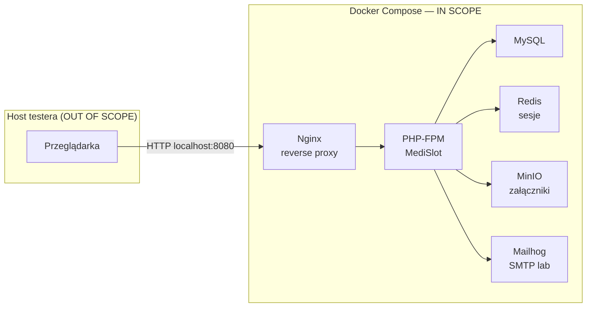
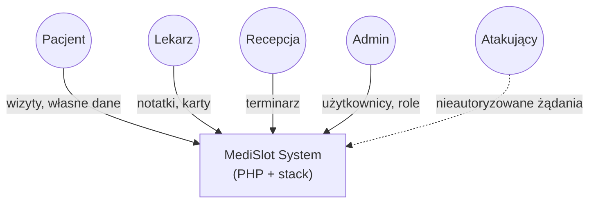
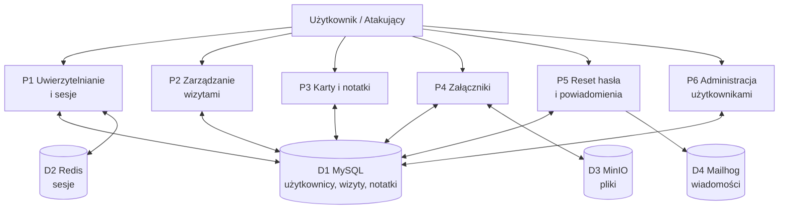

# Threat Model  
## MediSlot — NovaMed Sp. z o.o.

| Pole | Wartość |
|------|---------|
| Wersja | 1.0 |
| Data | 24.10.2026 |
| Powiązany SoW | `01-statement-of-work.md` |
| Metodyka | DFD + **STRIDE** + jakościowa ocena ryzyka |
| Status | Roboczy — etap I |

---

## 1. Streszczenie

System **MediSlot** to portal przychodni **NovaMed Sp. z o.o.** do rejestracji wizyt, prowadzenia syntetycznej dokumentacji pacjentów oraz zarządzania rolami personelu. Model zagrożeń obejmuje aplikację PHP oraz stack labowy (Nginx, MySQL, MinIO, Redis, Mailhog) uruchamiany w Docker Compose.

Celem dokumentu jest:

1. Ustalenie aktywów, aktorów i granic zaufania.  
2. Opisanie przepływów danych (DFD).  
3. Analiza STRIDE per element.  
4. Ocena ryzyka i propozycja mitigacji (w tym takich, które w labie celowo nie będą w pełni wdrożone — pod etap II).  
5. Wnioski pod SoW i fazę praktyczną.

---

## 2. Schemat architektury (rysunek wysokopoziomowy)

**Granica zaufania (trust boundary):** ruch wchodzi do labu wyłącznie przez Nginx na porcie labowym. MySQL, Redis i (docelowo) MinIO API nie powinny być konieczne do ekspozycji na host na potrzeby happy path — jeśli porty są opublikowane „dla wygody labu”, stanowi to osobne ryzyko (patrz STRIDE).

---

## 3. Aktorzy

| Aktor | Typ | Opis | Motywacja / wpływ |
|-------|-----|------|-------------------|
| Pacjent | Użytkownik legitymowany | Rejestruje się, umawia wizyty, przegląda własną dokumentację | Prywatność własnych danych; ewentualnie ciekawość cudzych kart |
| Lekarz | Użytkownik legitymowany | Notatki, podgląd pacjentów przypisanych | Dostęp do PHI syntetycznego; eskalacja poza przypisanie |
| Recepcja | Użytkownik legitymowany | Terminarz, dane kontaktowe, zakładanie wizyt | Szeroki dostęp operacyjny; nadużycie funkcji |
| Admin | Użytkownik legitymowany | Użytkownicy, role, konfiguracja | Pełna kompromitacja aplikacji przy przejęciu konta |
| Zewnętrzny atakujący | Zagrożenie | Ma dostęp do UI/API labu na localhost (w narracji: „internetowy” atakujący) | RCE, wyciek danych, przejęcie kont |
| Złośliwy insider (niższa rola) | Zagrożenie | Legitymowane konto pacjenta/recepcji | IDOR, horizontal/vertical privilege escalation |
| Proces / usługa (Nginx, PHP, DB…) | Element systemu | Komponenty stacku | Misconfig, CVE, słabe sekrety |

---

## 4. Zasoby (aktywa)

| ID | Aktywo | Poufność | Integralność | Dostępność | Uzasadnienie |
|----|--------|----------|--------------|------------|--------------|
| A1 | Konta i poświadczenia (4 role) | Wysoka | Wysoka | Średnia | Wejście do systemu |
| A2 | Sesje (Redis) | Wysoka | Wysoka | Średnia | Hijacking = przejęcie tożsamości |
| A3 | Dane wizyt i notatek lekarskich | Wysoka | Wysoka | Średnia | Rdzeń „PHI” syntetycznego |
| A4 | Załączniki w MinIO | Wysoka | Wysoka | Średnia | Skierowania, wyniki, dokumenty |
| A5 | Skrzynka Mailhog (tokeny resetu) | Wysoka | Średnia | Niska | Przejęcie konta przez reset |
| A6 | Sekrety (DB, MinIO, Redis) | Wysoka | Wysoka | Średnia | Lateral movement w labie |
| A7 | Runtime PHP / kod MediSlot | Wysoka | Wysoka | Wysoka | RCE = pełne przejęcie app |
| A8 | Logi Nginx/PHP | Średnia | Średnia | Niska | Ślady SOC / anty-forensics |

---

## 5. Diagram przepływu danych (DFD)

### 5.1. Kontekst (Level 0)

### 5.2. Level 1 — główne procesy i magazyny

### 5.3. Kluczowe przepływy (opis)

| ID | Przepływ | Dane | Trust boundary |
|----|----------|------|----------------|
| F1 | Login → P1 → D1/D2 | Identyfikator, hasło, session id | Tak (Internet/lab → app) |
| F2 | Rezerwacja wizyty → P2 → D1 | Termin, lekarz, pacjent | Tak + kontrola roli |
| F3 | Notatka lekarza → P3 → D1 | Treść medyczna | Tak + authz lekarz↔pacjent |
| F4 | Upload → P4 → D3 | Plik binarny + metadane w D1 | Tak; ryzyko path/RCE |
| F5 | Reset hasła → P5 → D4 | Token, link | Mailhog w labie = czytelny plaintext |
| F6 | Admin CRUD użytkowników → P6 → D1 | Role, hasła (hash) | Krytyczna powierzchnia |

---

## 6. Analiza STRIDE

Legenda wpływu: **C** Critical · **H** High · **M** Medium · **L** Low (jakościowo, przed CVSS w etapie III).

### 6.1. P1 — Uwierzytelnianie i sesje

| Threat | Opis | Wpływ | Powiązane aktywo |
|--------|------|-------|------------------|
| **S** Spoofing | Przejęcie sesji (przewidywalne ID, brak `HttpOnly`/`Secure`, sesja w Redis bez należytej izolacji) | H | A1, A2 |
| **T** Tampering | Modyfikacja cookie / payloadu resetu | H | A1, A5 |
| **R** Repudiation | Brak wiarygodnych logów logowań | L | A8 |
| **I** Information disclosure | Enumeration użytkowników na loginie/resetcie | M | A1 |
| **D** DoS | Flood logowań / fill Redis | L* | A2 |
| **E** Elevation | Pacjent → admin przez wadliwą zmianę roli / IDOR na profilu | C | A1 |

\*DoS hosta — out of scope; DoS aplikacji w labie — ograniczony.

### 6.2. P2 — Wizyty

| Threat | Opis | Wpływ |
|--------|------|-------|
| **S** | Podszywanie się pod pacjenta przy tworzeniu wizyty (brak spójności `patient_id` z sesją) | H |
| **T** | Zmiana `appointment_id` / statusu wizyty (IDOR) | H |
| **I** | Odczyt cudzych wizyt przez manipulację ID | H |
| **E** | Recepcja wykonuje akcje zarezerwowane dla admina | H |

### 6.3. P3 — Karty i notatki

| Threat | Opis | Wpływ |
|--------|------|-------|
| **T** | Podmiana notatki innego lekarza | H |
| **I** | Wyciek notatek (IDOR, brak filtra „przypisany pacjent”) | C/H |
| **T/I** | Stored XSS w notatce → sesja innego użytkownika | H |

### 6.4. P4 — Załączniki (MinIO)

| Threat | Opis | Wpływ |
|--------|------|-------|
| **T** | Upload bypass (Content-Type, podwójne rozszerzenie, path traversal w nazwie) | H |
| **E** | Łańcuch upload → wykonanie kodu (RCE) | C |
| **I** | Publiczny / zgadywalny URL obiektu MinIO | H |
| **S** | Użycie skradzionych kluczy MinIO | H |

### 6.5. P5 — Reset hasła i poczta

| Threat | Opis | Wpływ |
|--------|------|-------|
| **S/E** | Token resetu przewidywalny / wielokrotnego użytku / bez wygaśnięcia | H |
| **I** | Odczyt tokenów z Mailhog UI (w labie zamierzone; w produkcji = krytyczna luka procesu) | H |
| **T** | Podmiana adresu e-mail w procesie resetu | H |

### 6.6. P6 — Administracja

| Threat | Opis | Wpływ |
|--------|------|-------|
| **E** | Broken access control — endpointy admin bez sprawdzenia roli | C |
| **T** | Masowa zmiana ról | C |
| **I** | Listing wszystkich użytkowników i metadanych | M |

### 6.7. Komponenty infrastrukturalne

| Element | S | T | R | I | D | E | Komentarz |
|---------|---|---|---|---|---|---|-----------|
| **Nginx** | | request smuggling / zła podmiana nagłówków | słabe logi | server version, path disclosure | | | Misconfig proxy |
| **PHP-FPM** | | | | | | **CVE 2026 → RCE** | Primary critical path etapu II |
| **MySQL** | słabe credsy | | | SQLi na legacy endpoint | | | Część zapytań celowo słaba |
| **Redis** | brak auth | nadpisanie sesji | | dump kluczy | | session as admin | |
| **MinIO** | | | | listing bucket | | | Polityki zbyt luźne |
| **Mailhog** | | | | plaintext maili | | | Tylko lab — opisać jako ryzyko procesu |
| **Debian/obrazy** | | | | pakiety z CVE (Trivy/Lynis) | | | Low/Info + ewentualne High |

---

## 7. Ocena ryzyka (macierz jakościowa)

Skala: Prawdopodobieństwo × Wpływ → Ryzyko (1–5).

| ID | Zagrożenie | P | W | Ryzyko | Priorytet testów |
|----|------------|---|---|--------|------------------|
| R1 | RCE przez podatny PHP (CVE 2026) | 4 | 5 | **5** | Critical — RoE |
| R2 | RCE/łańcuch przez upload | 3 | 5 | **5** | Critical |
| R3 | IDOR na karty/notatki/wizyty | 5 | 4 | **5** | High |
| R4 | Vertical privilege escalation (rola) | 4 | 5 | **5** | Critical/High |
| R5 | Stored XSS → session theft | 4 | 4 | **4** | High/Medium |
| R6 | Słaby reset hasła + Mailhog | 4 | 4 | **4** | High/Medium |
| R7 | Session fixation / Redis misconfig | 3 | 4 | **4** | Medium |
| R8 | SQLi (legacy search/report) | 3 | 4 | **4** | Medium/High |
| R9 | Information disclosure (wersje, nagłówki, Trivy) | 5 | 2 | **3** | Low/Info |
| R10 | Enumeration kont | 4 | 2 | **2** | Low |

**Docelowy koszyk findingów etapu II (~15–20):** kilka pozycji z R1–R4 (Critical/High), większość z R5–R8 (Medium), kilka z R9–R10 oraz findingów skanerów (Low/Info).

---

## 8. Mitigacje

Podział: **M-PROD** = rekomendacja dla „prawdziwego” NovaMed; **M-LAB** = stan zamierzony w labie (celowa słabość lub częściowa kontrola).

| ID ryzyka | Mitigacje rekomendowane (M-PROD) | Stan labu (M-LAB) |
|-----------|----------------------------------|-------------------|
| R1 | Pinowanie/patch PHP, SBOM + Trivy w CI, minimalny obraz, WAF | Świadomie podatna wersja PHP pod CVE 2026 |
| R2 | Antywirus/scan upload, magazyn poza webroot, podpisane URL, konwersja plików | Częściowa whitelist + obejścia; możliwy łańcuch RCE |
| R3–R4 | Mandatory authz per resource (`owner`/`assignment`), testy ABAC, IDOR testy w CI | Role istnieją, ale celowe braki sprawdzeń |
| R5 | Escape kontekstowy, CSP, sanitizacja HTML (allowlista) | Sanitizacja niespójna między widokami |
| R6 | Tokeny kryptograficznie silne, jednorazowe, TTL; brak plaintext mail w prod | Mailhog + słabszy token (medium) |
| R7 | Redis AUTH, sesje rotowane po loginie, flagi cookie | Uproszczona konfiguracja sesji |
| R8 | Wyłącznie prepared statements, ORM, WAF SQLi | Główne CRUD OK; legacy endpoint podatny |
| R9 | Ukrycie wersji, hardening nagłówków, patch images | Część findingów zostawiona pod Lynis/Trivy |
| R10 | Jednolite komunikaty błędów logowania | Enumeration możliwa (Low) |

Dodatkowe mitigacje procesowe (SoW):

- Procedura RoE przy Critical.  
- Re-test Critical/High.  
- Segregacja sekretów (`.env` poza obrazem publicznym — w labie i tak lokalnie).

---

## 9. Założenia i ograniczenia modelu

1. Atakujący ma dostęp sieciowy do portów labowych MediSlot (w rzeczywistości: localhost zespołu).  
2. Brak osobnego IdP (Keycloak) — tożsamość w aplikacji PHP.  
3. Mailhog **nie modeluje** bezpieczeństwa prawdziwego SMTP; findingi z odczytu skrzynki traktować jako ryzyko procesu / lab-only z rekomendacją na produkcję.  
4. Threat model nie obejmuje fizycznego dostępu do hosta ani supply-chain IDE/CI poza obrazami Docker użytymi w Compose.  
5. Celowe podatności są częścią projektu dydaktycznego; mitigacje M-PROD pozostają wiążące dla raportu końcowego („co klient powinien zrobić”).

---

## 10. Wnioski

1. Najcenniejsze aktywa to **dokumentacja medyczna (A3/A4)** oraz **runtime aplikacji (A7)** — ich kompromitacja definiuje Critical.  
2. Największe ryzyka przed testem: **RCE (PHP CVE + upload)** oraz **broken access control między 4 rolami** — zgodne z happy path MediSlot.  
3. Stack 7 komponentów daje wystarczającą powierzchnię na wymóg „≥5 technologii” i na findingi z Trivy/Lynis (Low/Info) bez sztucznego doklejania usług.  
4. DFD Level 1 wskazuje jasne trust boundaries przy P1/P4/P5 — to priorytet discovery w etapie II.  
5. SoW (scope In/Out + RoE) jest spójny z tym modelem: testujemy lab Compose, eskalujemy Critical do kontaktu RoE, re-testujemy po patchach.  
6. Rekomendacja na etap II: zacząć od fingerprintingu PHP/obrazów → authz/IDOR na wizytach i kartach → upload/XSS/reset → eksploatacja CVE PHP jako tor Critical.

---

## 11. Artefakty do prezentacji (10 min)

Sugerowany układ slajdów:

1. Klient NovaMed + cel testu  
2. Architektura (rysunek z §2)  
3. Aktorzy i aktywa  
4. DFD Level 1  
5. Top ryzyka (tabela §7)  
6. Mitigacje vs stan labu  
7. Link do SoW / dalsze kroki

---

## 12. Podział prac (narracja dokumentacyjna)

| Osoba | Wkład w Threat Model |
|-------|----------------------|
| Kamil | Architektura, STRIDE infra/PHP, mitigacje R1–R2 |
| Bartek | Aktorzy SOC, ryzyka R5–R7, procedura eskalacji |
| Kuba | DFD procesów biznesowych, aktywa A3–A5, wnioski biznesowe |

---

*Dokument spełnia checklistę etapu I: schemat, zasoby i aktorzy, DFD, STRIDE, ocena ryzyka, mitigacje, wnioski.*
